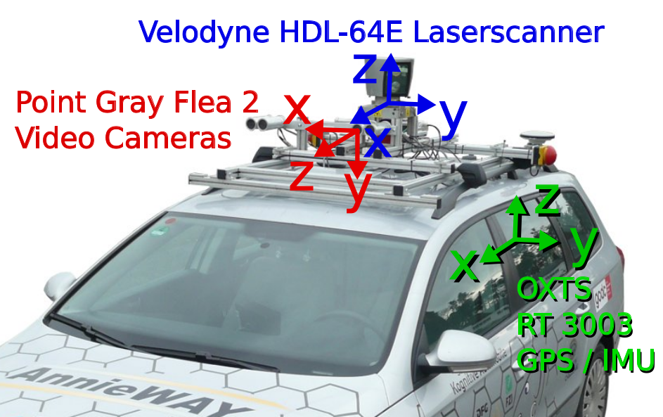
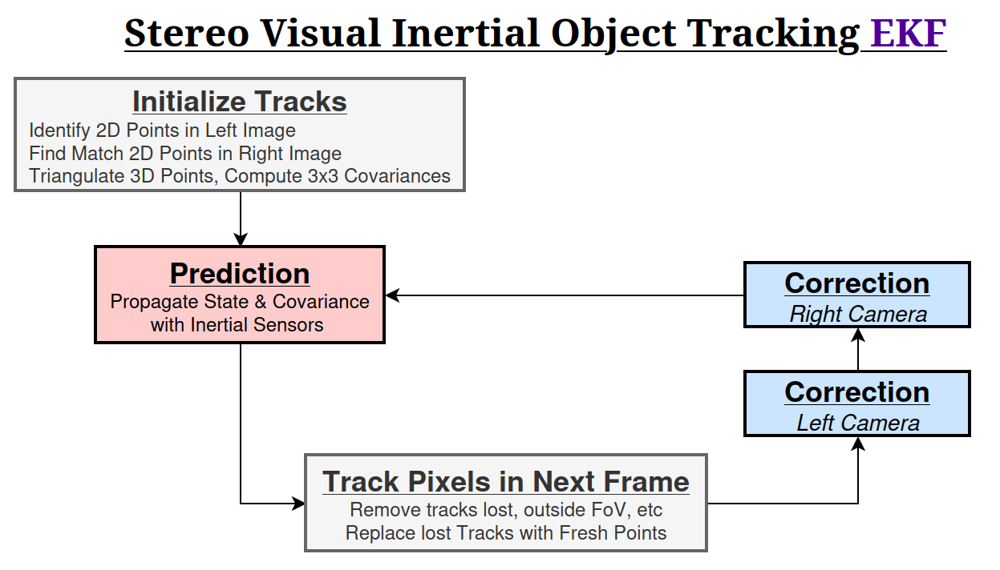
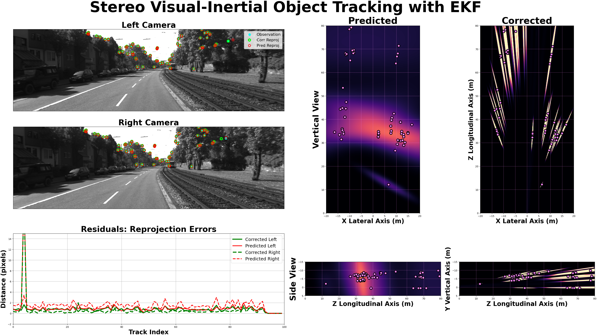
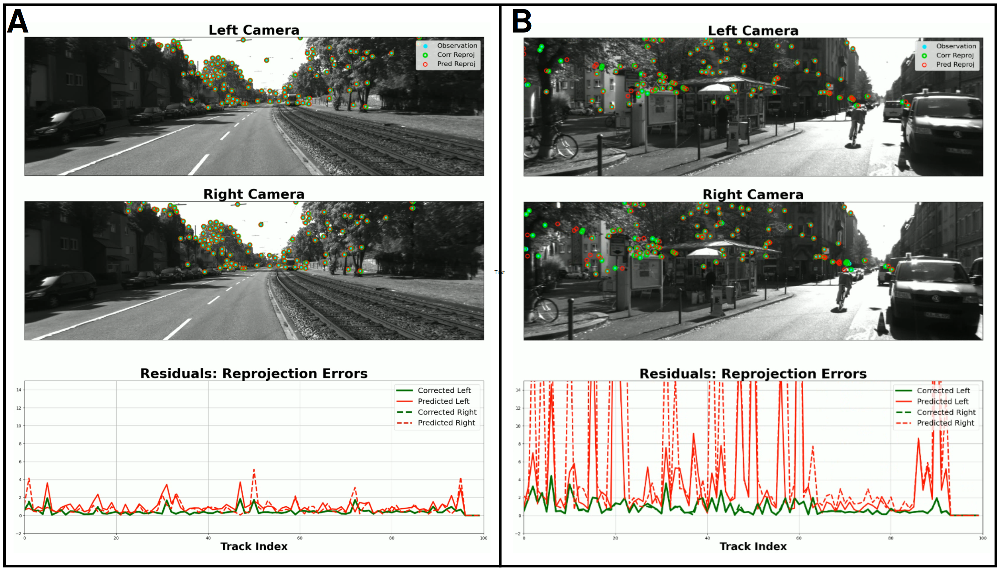

# Stereo Visual-Inertial Object Tracking with Iterated-EKF

[Full Output Video Recordings on YouTube](https://www.youtube.com/watch?v=tfgrQTp6jsU&list=PL9IYlUueNFoa8mLsTHtWhH6aflSdcyqWZ&index=1)

## Summary 

This EKF tracks 3D points ($3 \times 1$ Mean & $3 \times 3$ Covariance) observed as 2D visual features in KITTI stereo camera dataset, in the local Left-Camera Frame.

    

**Fig 1**: KITTI Recording Platform *(Geiger et al, 2013)*

    

**Fig 2**: Stereo Visual Inertial Object Tracking with I-EKF

Tracks are initialized as 3D **DLT Triangulation** between image feature point pairs.
**Lukas-Kanade Optical Flow** tracks a point observation in Left Camera across time, and **Template-Matching** finds the corresponding point in Right Camera.

- The Prediction Step propagates the Track-Distributions using IMU-based translational & rotational velocities.
- The $4 \times 1$ measurement-vector $z$ vertically stacks both $2 \times 1$ $(row, col)$ pixels, $z_{left}$ and $z_{right}$. i.e. The observations in both cameras constitute a **single Measurement**, and are processed in a **single Correction Step**. 
- The Measurement Model is the standard $3 \times 4$ **Camera-Projection Matrix** $\mathbf{P}$, followed by the _divide-by-z_ normalization of the Homogeneous Coordinate (Hartley, 2003). Hence, **the model is non-linear** $z = h(x)$. The $4 \times 3$ Measurement Jacobian $\mathbf{H}$ vertically stacks both $2 \times 3$ Measurement Jacobians $H_{left}$ and $H_{right}$. 
- The $4 \times 1$ residual/innovation vector is the "Reprojection Error", $z - h(\hat{x})$ (i.e. difference between observed and predicted pixel coordinates).

**Iterated**-EKF: 
The majority of tracks achieve post-correction residuals below $2$ pixels **after a single correction**.

Nonetheless, the Correction Step repeats the Mean (not Covariance) Update until either **(a)** the residual falls below a threshold ($2$ pixels), or **(b)** N iterations pass.  

    

**Fig 3**: EKF Visualization Screenshot (see YT link for full videos)

## 1. Feature Detection, Initialization, & Tracking
Upon Track Initialization, features in Left Camera are detected via **Shi-Tomasi Corner Detection** provided by `cv2.goodFeaturesToTrack`.
The optimal matching pixel coordinate is found in the Right Camera via `ski.feature.match_template()`. 
The Each pixel coordinate pair is (with the calibrated Left & Right 3x4 camera matrices) triangulated via `cv2.triangulatePoints()`. 
The DLT Triangulation is **only** used for Track initialization, and never again. 
The resulting coordinates are in meters.
The (moving) Left Camera is the Origin coordinate system defined as: 

`x = right, y = down, z = forward`. 

Features are tracked over successive frames via **Lukas-Kanade Optical Flow** provided by `cv2.calcOpticalFlowPyrLK()`.
The same Template-Matching is used on each time-step/frame to find the Right-Image correspondence.
A new feature is initialized each time a feature leaves the field of view, or is lost by the tracker.

## 2. State Space & Prediction Step
Each tracked point is represented as **3-D Gaussian Distribution**

$$
\mu = \begin{bmatrix} \mu_x \\ 
                      \mu_y \\ 
                      \mu_z \end{bmatrix},
$$

$$
\Sigma = \begin{bmatrix} \sigma_x^2 & \sigma_{xy} & \sigma_{xz} \\ 
                         \sigma_{yx} & \sigma_y^2 & \sigma_{yz} \\ 
                         \sigma_{zx} & \sigma_{zy} & \sigma_z^2 \end{bmatrix}
$$

### 2.1 Initialize Track Covariance Matrix
Triangulation accuracy is highly **quantized** along the Z-axis with rapidly decreasing resolution.

    

**Fig 4**: Quantization of Depth Resolution Degrades Rapidly along Line-of-Sight $z$*

For the KITTI Camera, this variance as a function of depth $z$ is:

$\sigma_z^2 = \frac{z^4 \sigma_{\text{pix}}^2}{387.5744^2}$

The Yaw\Pitch line-of-sight angles of a pixel are:
$\theta_\text{yaw} = \tan^{-1}\left(\frac{x}{z}\right)$ and $\theta_\text{pitch} = \tan^{-1}\left(\frac{y}{z}\right)$
So, the variance along the (off-center) line-of-sight becomes:

$\sigma_z^2 = \frac{z^4 \sigma_{\text{pix}}^2}{387.5744^2 \cos{\theta_\text{yaw}} \cos{\theta_\text{pitch}}}$

Assuming $\sigma_x^2 = \sigma_y^2 = \sigma_z^2/100.0$, then:

$$
\Sigma = \begin{bmatrix} \sigma_x^2 & 0.0 & 0.0 \\ 
                          0.0 & \sigma_y^2 & 0.0 \\ 
                          0.0 & 0.0 & \sigma_z^2 \end{bmatrix}
$$

can be rotated into the **pixel LoS**:
$\Sigma_\text{initial} = R_x R_y \Sigma R_y^T R_x^T$

Below are initialized covariance matrices of each Track.

    

**Fig 5**: Initialized Track Covariances are rotated into the pixel Line-of-Sight

### 2.2 Prediction Step
The camera undergoes translation along $z$ (forward) and $x$ (lateral) axes, and undergoes rotation about $y$ (yaw) and $x$ (pitch) axes.
These are "control inputs", and are applied to the points in the following **State Transition Model**

$$
    \mu_{\text{predicted}} = R_x R_y (\mu - \delta_\text{shift})
$$

$$
\mu_{\text{predicted}} = \begin{bmatrix} 1.0 & 0.0 & 0.0 \\ 
                        0.0 & \cos(\delta_\text{pitch}) & -\sin(\delta_\text{pitch}) \\ 
                        0.0 & \sin(\delta_\text{pitch}) & \cos(\delta_\text{pitch}) \end{bmatrix} 
                        \begin{bmatrix} \cos(\delta_\text{yaw}) & 0.0 & \sin(\delta_\text{yaw}) \\ 
                                                                0.0 & 1.0 & 0.0 \\ 
                                        -\sin(\delta_\text{yaw}) & 0.0 & \cos(\delta_\text{yaw}) \end{bmatrix} 
                        \left( \begin{bmatrix} \mu_x \\ 
                                               \mu_y \\ 
                                               \mu_z \end{bmatrix} - \begin{bmatrix} \delta_x \\ 
                                                                                          0.0 \\ 
                                                                                          \delta_z \end{bmatrix} \right)
$$

The predicted Covariance Matrix is

$$
    \Sigma_\text{predicted} = R_x R_y \Sigma R_y^T R_x^T + Q
$$

### 2.3 Compute Process Noise $Q$
Transforming the covariance of control inputs into state-space via:

$Q = J_Q \Sigma_U J_Q^T$

where $\Sigma_U$ is the covariance of control inputs

$$
\Sigma_U = \begin{bmatrix} \sigma_{\delta x}^2 & 0.0 & 0.0 & 0.0 \\ 
                           0.0 & \sigma_{\delta z}^2 & 0.0 & 0.0 \\ 
                           0.0 & 0.0 & \sigma_{\delta \text{yaw}}^2 & 0.0 \\ 
                           0.0 & 0.0 & 0.0 & \sigma_{\delta \text{pitch}}^2 \end{bmatrix}
$$

(the values are estimated as per Motion Model in *Probabilistic Robotics by Thrun et al*)

and $J_Q$ is the Jacobian of the State-Transition-Model with respect to the Control Parameters

$$
J = \begin{bmatrix} -1.0 & 0 & -1.0 \cdot \delta_z + 1.0 \cdot \mu_z & 0 \\ 
                                            0 & 0 & 0 & \delta_z - \mu_z \\ 
                                            0 & -1 & \delta_x - \mu_x & 1.0 \cdot \mu_y \end{bmatrix}
$$

(assuming $\delta_\text{yaw} = \delta_\text{pitch} = 0.0$ for simplicity)

As expected, the Predicted Covariance matrix $\Sigma_\text{pred}$ _diffuses_ along the camera yaw\pitch angles. 

    

**Fig 6**: Predicted\Extrapolated Covariances injects noise due to motion variance in $\delta$ forward\right\yaw\pitch.

i.e. noise in camera yaw\pitch adds uncertainty horizontally\vertically and increasingly so as a function of point distance $z$ (_like a lever-arm_).

## 3. Measurement Space, Projection Model, & Correction Step
Each camera observes $2 \times 1$ feature (origin is the upper left corner of the image):

$$
z_{cam} = \begin{bmatrix} x_{row}  \\ 
                          y_{col} \end{bmatrix}   
$$

The EKF measurement vector is $4 \times 1$

$$
z  = \begin{bmatrix} z_{Left}  \\ 
                     z_{Right} \end{bmatrix}   
$$

### 3.1 Compute Jacobian of Projection Model $H$
The standard $3 \times 4$ Camera projection $\mathbf{P}$ is applied to world point $\mathbf{x}$ as:

$$
\mathbf{Px} = \begin{bmatrix} f_x & 0.0 & p_x & f_{x}b_{x} \\ 
                              0.0 & f_y & p_y & 0.0        \\ 
                              0.0 & 0.0 & 1.0 & 0.0 \end{bmatrix}   \begin{bmatrix} x \\ 
                                                                                    y \\ 
                                                                                    z \\ 
                                                                                     1.0 \end{bmatrix}
$$

where the baseline $b_x$ is $0.0$ for Left-Cam, and $0.54$ for Right-Cam.
The homogeneous coordinate is normalized and removed by dividing the result by $z$.

$$
h(\mathbf{x}) = \frac{\mathbf{P}}{z}\mathbf{x} =
                \begin{bmatrix} \frac{f_x}{z} &           0.0 & \frac{c_x}{z} & \frac{f_{x}b_{x}}{z} \\ 
                                         0.0  & \frac{f_y}{z} & \frac{c_y}{z} &       0.0        \end{bmatrix}  
                \begin{bmatrix} x \\
                                y \\
                                z \\
                                1.0 \end{bmatrix}
$$

$$
h(\mathbf{x}) = \begin{bmatrix} h_{Left}(\mathbf{x}) \\ 
                                h_{Right}(\mathbf{x}) \end{bmatrix}
$$

The normalization makes $h(\mathbf{x})$ a **non-linear model**, and hence it must be linearized into a Jacobian for usage in the Measurement-Correction step.

$$
    \boxed{\mathbf{H} = \begin{bmatrix} \frac{f_x}{Z} & 0.0 & -\frac{f_x \cdot X}{Z^2} -\frac{f_{x}b_{x}}{Z^2} \\ 
                                                  0.0 & \frac{f_y}{Z} & -\frac{f_y \cdot Y}{Z^2}                           \end{bmatrix}}
$$

The $4 \times 3$ Measurement Jacobian is:

$$
    \boxed{\mathbf{H} = \begin{bmatrix} \mathbf{H}_{Left} \\ 
                                        \mathbf{H}_{Right} \end{bmatrix}}
$$

This "Projection Jacobian" is the **key** to the Measurement Correction, as shown below.
### 3.2 Measurement Correction of Prediction
Given:

**Tracked Feature** $z$

**Kalman Gain** $K = \Sigma_\text{pred}H^T (H\Sigma_\text{pred}H^T + R)^{-1}$,

the optimal\corrected track distribution becomes:

$$
    \mu_\text{corrected} = \mu_\text{pred} + K (z - h(\mu_\text{pred}))
$$

$$
   \Sigma_\text{corrected} = (I-KH)\Sigma_\text{pred}(I-KH)^T + KRK^T  
$$

As expected, the Measurement Corrected Covariance matrices $\Sigma_\text{corrected}$ appear as _needles_ along the pixel _line-of-sight_.

    

**Fig 7**: Measurement Corrected Covariances are "sharpened" along the pixel Line-of-Sight due to Projection-Jacobian $H$

i.e. Cameras isolate objects in _angle_, but not in _range_.

## 4. Results
The VIT-EKF runs successfully.
The performance of the VIT-EKF is evaluated according to the Pre and Post Measurement-Correction "Reprojection Error". i.e.

$\epsilon_\text{predicted} = z - h(\mu_\text{predicted})$

$\epsilon_\text{corrected} = z - h(\mu_\text{corrected})$

The **Innovation** or **Pre-Fit Residual** $\epsilon_\text{pred}$ *drives* the predicted state towards the measurement corrected state via the **Kalman Gain**

The reprojection of 3D points which undergo IMU-based Prediction Model "track" their 2D features with remarkable accuracy. 
However, due to triangulation, and IMU errors, predicted points rapidly accrue significant reprojection/residual errors.

The Measurement-Correction consistently and significantly reduced these reprojection errors most often to zero pixels, but not always. e.g.
 
- Scenario A: the camera follows a straight line with simple and distant 3D features. 
- Scenario B: the camera rotates often with complex nearby 3D features.

    

**Fig 8**: Predicted Track Reprojection always exceed Corrected Track Reprojection. 

Clearly, the Scenario B experiences more Prediction residual error, but nonetheless manages to reduce the errors to near zero in Post Correction residual error.

**Main Issue Observed**

2D Features do not always "exit" the field-of-view neatly.
The Feature-Tracking algorithm stubbornly re-assigns the track to nearby similar features rather than labeling it "gone". 

## 5. Conclusions, Open Points, & Follow-Up Steps

The main "discovery" of this project is the Jacobian of the camera projection model: 

$$
    \boxed{\mathbf{H} = \begin{bmatrix} \frac{f_x}{Z} & 0.0 & -\frac{f_x \cdot X}{Z^2} -\frac{f_{x}b_{x}}{Z^2} \\ 
                                                  0.0 & \frac{f_y}{Z} & -\frac{f_y \cdot Y}{Z^2}                           \end{bmatrix}}
$$

This Jacobian enables any Kalman Filter to incorporate visual features into it's Measurement-Correction step.
Furthermore, performing the Measurement Correction with both Left & Right measurements simultaneously exploits the cross-covariance between them (the $4 \times 4$ denominator of Kalman Gain).

The Prediction-Model assumes _stationary objects_ seen from a moving camera.
Nonetheless, the `VIT-EKF` successfully _tracks moving objects_ due to the measurement correction (even though the Predicted (Pre-Fit) Residual would be large).

Hence, a possible follow up feature would be to _identify moving objects_ by comparing Pre\Post-Fit Residual differences across tracks.

**$Q$, $R$, & $\Sigma_{init}$ Tuning:** This project made pure guesses, and rough approximations for the Process noise $Q$, Measurement noise $R$, and initial Track covariance $\Sigma_{init}$. A more rigorous process should be applied here.
